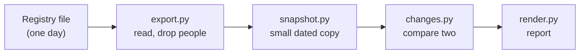

<p>
  <a href="https://clinx.org">
    <picture>
      <source media="(prefers-color-scheme: dark)" srcset="https://raw.githubusercontent.com/VVillBerchtold/clinx-org/main/public/brand/clinx-wordmark-on-dark.svg">
      
    </picture>
  </a>
</p>

# clinx-radar

A small tool that notices what changed in the federal 340B registry.

The registry lists every hospital and clinic in the 340B drug program, with its status and its contract pharmacies. It shows today only. Yesterday's version is gone. So the only way to see that a clinic was terminated, renamed or gained a pharmacy is to keep a dated copy and compare two of them. That is all this tool does:

1. it keeps a small, dated copy of the registry (a **snapshot**), and
2. it compares two snapshots and writes a plain **change report**.

It says what changed between two dates. It never says why.

## What a report looks like

This is part of the report from the made-up example in this repository:

> **Changes between 2026-01-01 and 2026-01-02**
>
> | Kind | Count |
> | --- | --- |
> | Entities added | 1 |
> | Entities removed | 1 |
> | Terminations | 1 |
> | Reinstatements | 1 |
> | Field changes | 2 |
> | Contract pharmacies added | 1 |
> | Contract pharmacies removed | 1 |
> | Contract pharmacies newly terminated | 1 |
>
> **Terminations (1)**
>
> | 340B ID | Name | Participating before | Participating after | Termination date before | Termination date after |
> | --- | --- | --- | --- | --- | --- |
> | CH99902 | Example Clinic Two | yes | no | (none) | 2026-02-01 |
>
> **Field changes (2)**
>
> | 340B ID | Name | Field | Before | After |
> | --- | --- | --- | --- | --- |
> | CH99905 | Example Clinic Five Renamed | name | Example Clinic Five | Example Clinic Five Renamed |
> | CH99905 | Example Clinic Five Renamed | street.line1 | 1 Example Street | 2 Example Street |

The full report has one table for each kind of change. It can also be written as JSON.

## Try it in a minute

You need [uv](https://docs.astral.sh/uv/) and Python 3.12. The folder `examples/` holds two small made-up registry files. Every entity, name and address in them is invented.

Install it:

```bash
uv sync
```

Make a snapshot of each day:

```bash
uv run opais snapshot examples/export-day1.json --date 2026-01-01 --out snapshots/day1.json
```

```bash
uv run opais snapshot examples/export-day2.json --date 2026-01-02 --out snapshots/day2.json
```

Compare them:

```bash
uv run opais changes snapshots/day1.json snapshots/day2.json
```

To look at one state or one entity, add `--state RI` or `--id CH99901`.

## People are not kept

The registry's file names people: for each entity, an authorizing official and a primary contact, with titles and phone numbers. A tool that tracks organizations has no business keeping them.

| In the registry's file | In a snapshot or report |
|---|---|
| The entity: 340B ID, name, type, status, dates, addresses | Kept |
| Its contract pharmacies: name, address, dates | Kept |
| Authorizing official and primary contact (name, title, phone) | **Dropped when the file is read** |
| Pharmacy phone numbers | **Dropped** |
| Free-text comments | **Dropped** |
| Any field the tool does not know | **Dropped**; only the field's name is counted |

The rule is "keep only what is on the list", not "remove what looks personal". A new field in the registry's file is thrown away until a person adds it to the list. `opais inspect` shows what was kept and what was dropped by field name, and never prints a value from the file.

The made-up example files carry the personal fields too, so you can watch them being dropped.

## How it is put together



| Where | What is in it |
|---|---|
| `src/opais/export.py` | Reads the registry's file. Holds the one list of fields that are kept |
| `src/opais/model.py` | The shape of an entity, an address and a contract pharmacy |
| `src/opais/snapshot.py` | Writes and reads a snapshot |
| `src/opais/changes.py` | Compares two snapshots and decides whether the amount of change is unusual |
| `src/opais/render.py` | Writes the report as Markdown or JSON |
| `src/opais/pull.py` | Optional: fetches today's file from the registry's public page |
| `src/opais/cli.py` | The `opais` command |
| `examples/` | Two made-up registry files to try it on |
| `tests/` | 115 tests, all on made-up data |
| `docs/` | Longer notes, one topic to a page |

The command is `opais`, after OPAIS, the registry's own name (the 340B Office of Pharmacy Affairs Information System, run by HRSA).

## Built to be careful

- **The same input always gives the same snapshot, byte for byte.** Nothing in a snapshot comes from a clock, and everything is sorted. Two people who snapshot the same file get identical files.
- **A tripwire for odd days.** If the registry's file is cut short, or far more changed than usual, the comparison says so and exits with a different code. A scheduled job can then stop and ask a person, not publish a broken report. See [the change report](docs/the-change-report.md#the-tripwire).
- **A typo is not "no changes".** Asking for a 340B ID that is in neither snapshot is an error that names the ID.
- **Nothing to install besides Python** for reading, snapshots and reports. The library has no runtime dependencies.
- **Honest fetching.** `opais pull` opens one public page, presses one button, once. It does not retry, and it does not pretend to be a person. See [getting the registry's file](docs/getting-the-file.md).
- **Strictly typed and linted.** Every commit passes `mypy --strict`, `ruff` and the tests.

## Where it is used

[clinx.org](https://clinx.org) runs this tool once a month to refresh its copy of the registry. The rest of the project:

| Repository | What it is |
|---|---|
| [clinx-340b](https://github.com/VVillBerchtold/clinx-340b) | The dataset of state 340B filings |
| clinx-radar (you are here) | What changed in the federal registry |
| [clinx-org](https://github.com/VVillBerchtold/clinx-org) | The website |

## Read more

- [The change report](docs/the-change-report.md): what it lists, filters, the tripwire and exit codes.
- [Getting the registry's file](docs/getting-the-file.md): by hand or with `opais pull`, and keeping the raw file private.
- [The registry's file and the field list](docs/the-registry-file.md): its shape, `opais inspect`, and how to add a field.
- [Changelog](CHANGELOG.md) and [how to contribute](CONTRIBUTING.md).

This is version 0.1.0. The layout and the output may still change before the first release.

## Licence

MIT. See [LICENSE](LICENSE).
